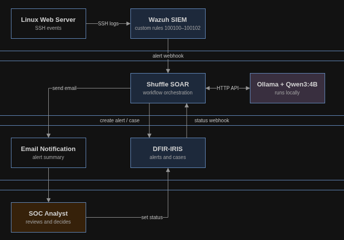

<div align="center">

# 🛡️ AI-Driven SOC Automation

### AI-Assisted Security Monitoring, SOAR & Incident Management

A practical SOC automation project integrating Wazuh, local AI analysis, Shuffle SOAR, and DFIR-IRIS to streamline security alert handling and incident investigation.

**Threat Detection · Local AI · SOAR · Incident Management**

<br>


</div>

---

## 📌 Project Overview

This project explores how security monitoring, local AI-assisted analysis, security orchestration, and incident management can work together in a practical Security Operations Center (SOC) environment.

The objective is to automate repetitive analyst tasks while maintaining visibility over security events and keeping the analyst involved in incident triage.

The implemented workflows cover:

- Custom Wazuh rules for suspicious SSH authentication activity.
- Local AI-assisted alert analysis using Ollama and Qwen3:4B.
- Automated alert creation in DFIR-IRIS.
- Email notifications containing alert information and original evidence.
- Analyst-driven alert escalation into incident cases.

## 🏗️ Architecture

The architecture integrates four main security components:

| Component | Role |
|---|---|
| **Wazuh SIEM** | Detects suspicious SSH authentication activity using custom rules. |
| **Ollama + Qwen3:4B** | Analyzes supplied alert evidence locally and generates a concise summary. |
| **Shuffle SOAR** | Orchestrates alert processing, AI analysis, API requests, and notifications. |
| **DFIR-IRIS** | Manages security alerts and incident investigation cases. |

Email notifications deliver the alert summary, original evidence, and decision guidance to the analyst.

### End-to-End Architecture Diagram

The diagram below illustrates the detection pipeline, local AI integration, email notification, and analyst-driven incident escalation.



---

# 🔍 1. Security Detection — Wazuh

Wazuh monitors SSH authentication events and applies three custom rules to identify suspicious login patterns.

| Rule ID | Detection | Wazuh Severity |
|---|---|---:|
| `100100` | Five failed SSH password attempts from the same source IP within 60 seconds. | 10 |
| `100101` | Five SSH attempts using nonexistent usernames from the same source IP within 60 seconds. | 10 |
| `100102` | Successful SSH authentication following repeated failed attempts. | 12 |

Rule `100102` is particularly important because a successful login following repeated failures can indicate a potentially compromised account.

This detection is an indicator requiring investigation, not proof of compromise.

The custom rules also include MITRE ATT&CK mappings. Rule `100102` maps to:

- **T1110.001 — Password Guessing**
- **T1078 — Valid Accounts**

### Wazuh — SSH Detection Dashboard

The dashboard displays SSH-related security events, including their distribution across detection rules, severity levels, MITRE ATT&CK techniques, and the monitored agent.


### Rule 100102 — Successful Login After Repeated Failures

This event view demonstrates the detection of a successful SSH login following repeated authentication failures.


---

# 🤖 2. Local AI Analysis — Ollama & Qwen3:4B

A key part of this project is the integration of a locally running language model into the SOC workflow.

The project uses **Ollama with Qwen3:4B** to generate concise, evidence-based summaries of security alerts.

Instead of relying on a cloud-based AI API, Shuffle sends alert evidence to the local Ollama API.

## How the AI Integration Works

```text
Wazuh Security Alert
         |
         v
    Shuffle SOAR
         |
         | HTTP POST
         v
 Ollama /api/chat
         |
         v
     Qwen3:4B
   Local AI Model
         |
         | JSON Response
         v
    Python Parse
         |
         v
 DFIR-IRIS + Email
```

### Model Configuration

| Setting | Value |
|---|---|
| Runtime | Ollama |
| Model | `qwen3:4b` |
| API endpoint | `/api/chat` |
| Streaming | Disabled |
| Temperature | `0` |
| Maximum generated tokens | `200` |
| Output format | Structured JSON |
| Expected output field | `summary` |

### What Information Does the Model Receive?

The prompt supplies relevant information from the Wazuh alert, including:

- Wazuh rule ID.
- Source IP address.
- Target username.
- Previous failed-attempt evidence.
- Current authentication log entry.

The model is instructed to return exactly two short sentences in a JSON object containing a `summary` field.

The first sentence describes what happened. The second explains why it matters or what remains unknown.

The prompt also instructs the model to use only the supplied evidence, avoid inventing details, and avoid declaring an account compromised without sufficient evidence.

### AI Analysis vs. Severity Classification

**The AI summarizes the alert; Wazuh assigns the detection rule and its severity level.**

Qwen3:4B does not independently determine the Wazuh rule level, recalculate alert severity, or authorize a response.

This separation keeps detection logic distinct from AI-assisted interpretation.

### Shuffle — AI-Assisted Workflow Execution

The following screenshot shows the workflow execution, including the processing stages and the successful HTTP response from the DFIR-IRIS alert creation request.


**Additional evidence:** A dedicated screenshot of the successful Ollama HTTP node showing the `qwen3:4b` response and its generated `summary` would provide even clearer evidence of the local AI integration.

---

# ⚙️ 3. Automated SOC Workflow — Shuffle SOAR

The first Shuffle workflow automates the handling of incoming Wazuh alerts.

### Workflow

```text
SSH Authentication Activity
            |
            v
       Wazuh SIEM
            |
            | Alert Webhook
            v
       Shuffle SOAR
            |
            v
    Ollama + Qwen3:4B
            |
            v
       Python Parse
            |
            v
  DFIR-IRIS Alert Creation
            |
            v
     Email Notification
            |
            v
       SOC Analyst
```

### Processing Steps

**1. Detection:** Wazuh identifies suspicious SSH authentication activity using a custom rule.

**2. AI analysis:** Shuffle submits relevant alert evidence to the locally running Qwen3:4B model through Ollama.

**3. Response parsing:** A Python node processes the model's JSON response.

**4. Alert creation:** Shuffle sends the processed information to DFIR-IRIS through its API.

**5. Notification:** An email notification is sent to the analyst.

### Shuffle — Complete Detection Workflow

This screenshot shows the connected nodes in the `BruteForce-SSH` workflow.


### Shuffle — Execution Results

The execution results provide evidence of the processing steps and successful HTTP responses from the downstream integration.


---

# 📋 4. DFIR-IRIS — Security Alerts

DFIR-IRIS provides a centralized place to review security alerts and organize investigations.

The project uses Shuffle to submit processed alert information to DFIR-IRIS through the alert creation endpoint.

The alert views below demonstrate how SSH-related detections appear in the incident-management platform.

### SSH Brute-Force Alert — Alert #98

This example shows an SSH brute-force alert in DFIR-IRIS, including its classification, technical information, impact assessment, and guidance for the analyst's decision.


### Correlated SSH Alerts

This view groups two related alerts within an investigation:

- **Alert #97:** SSH login succeeded after brute force — High.
- **Alert #98:** SSH brute-force attempt — Medium.

Viewing related alerts together helps the analyst investigate the sequence of failed and successful authentication events.


### Understanding Severity

Wazuh rule levels and DFIR-IRIS severity classifications serve different purposes and should not be treated as identical numeric scales.

Wazuh rule levels are assigned by the detection rules. The alert shown in DFIR-IRIS also has its own severity and confidence assessment.

The local AI prompt summarizes the supplied evidence; it does not independently assign these severity values.

---

# 📧 5. Automated Email Notification

After processing an alert, Shuffle sends an email notification to the analyst.

The email provides alert information and supporting evidence to help the analyst evaluate the event.

The following two screenshots are complementary parts of the same email.

### Email — Alert Summary

The first screenshot shows the notification title, alert classification, Wazuh rule information, and MITRE ATT&CK details.


### Email — Original Evidence & Analyst Decision Guide

The second screenshot continues the same email with the original SSH authentication evidence and decision guidance for handling the alert in DFIR-IRIS.


Together, these screenshots show how the workflow provides both the alert summary and the underlying evidence needed for investigation.

---

# 🚨 6. Human-in-the-Loop — Incident Escalation

The second Shuffle workflow connects alert status changes in DFIR-IRIS to incident-management actions.

A webhook receives an alert status update and a decision node selects the appropriate branch.

### Workflow Logic

```text
    Analyst Updates Alert
             |
             v
        DFIR-IRIS
             |
             | Status Webhook
             v
        Shuffle SOAR
             |
             v
       Status Decision
         /         \
        /           \
 In Progress        Closed
      |                 |
      v                 v
 Create Incident    Add Comment
      Case          to the Alert
```

### When the Status Is `In Progress`

Shuffle calls the DFIR-IRIS API to escalate the alert and create an incident case.

### When the Status Is `Closed`

Shuffle calls the DFIR-IRIS API to add a comment to the existing alert instead of creating an escalation case.

### Shuffle — Human-in-the-Loop Workflow


### DFIR-IRIS — Incident Case

The case view provides a consolidated record for investigating the SSH-related incident.


### Investigation Details — Rule 100102

The investigation details include evidence of a successful SSH login following repeated failures and information for evaluating appropriate next steps.


---

# 🔐 7. Planned Development — Analyst-Approved Response

The current workflows provide detection, AI-assisted analysis, alert creation, email notification, and analyst-driven incident escalation.

The next development stage is to integrate containment actions into the existing workflow.

Planned capabilities include:

- Blocking a suspicious source IP.
- Disabling a confirmed compromised local account.
- Requiring explicit analyst authorization before a response executes.
- Recording response actions for investigation and auditing.

**Status: Under development.**

These containment actions are not presented as implemented features of the current workflows.

The intended design is to keep the analyst in control of security-sensitive operations.

---

# 🧰 8. Technology Stack

| Technology | Purpose |
|---|---|
| Wazuh | Security monitoring and detection |
| Ollama | Local language-model runtime |
| Qwen3:4B | AI-assisted alert summarization |
| Shuffle SOAR | Workflow orchestration and automation |
| DFIR-IRIS | Alert management and incident investigation |
| REST APIs | Communication between security components |
| Webhooks | Event-driven workflow execution |
| Python | Workflow response parsing |
| JSON | Rules, prompts, and structured model responses |
| Linux | Security lab environment |

---

# 📂 9. Repository Structure

```text
ai-soc-automation/
├── ai-analysis/
│   └── prompts/
│       └── alert-analysis.json
├── shuffle/
│   └── workflows/
│       ├── BruteForce-SSH.json
│       └── Human-in-the-Loop Approval.json
├── wazuh/
│   ├── active-response/
│   │   └── README.md
│   └── rules/
│       └── local_rules.xml
├── screenshots/
│   ├── architecture.png
│   └── ...
├── .gitignore
└── README.md
```

---

# 🎯 10. Skills Demonstrated

- SIEM monitoring and custom detection rule configuration
- SSH brute-force detection and authentication-event correlation
- MITRE ATT&CK mapping
- Local language-model deployment using Ollama
- AI-assisted security alert summarization
- SOAR workflow development
- REST API and webhook integration
- Automated alert creation and email notification
- Incident triage and escalation
- Human-in-the-loop automation design
- Security workflow documentation

---

# 🔒 Security Considerations

- AI-generated summaries are supporting information, not authoritative security decisions.
- Suspicious activity does not automatically prove account compromise.
- Response actions should require explicit analyst authorization.
- API credentials, passwords, session cookies, and private keys must not be committed to the repository.
- Screenshots should be reviewed for sensitive information before publication.
- Testing should be performed in an authorized lab environment.

---

# 👨‍💻 Author

**Yassine Nemri**

Cybersecurity Engineering Student  
Interests: SOC Operations · Security Automation · AI-Assisted Threat Analysis

- GitHub: [@Yassine1Nemri](https://github.com/Yassine1Nemri)
- Project: [AI-Driven SOC Automation](https://github.com/Yassine1Nemri/ai-soc-automation)

---

<div align="center">

**Built to explore practical SOC automation through security engineering, local AI, and controlled incident handling.**

</div>
